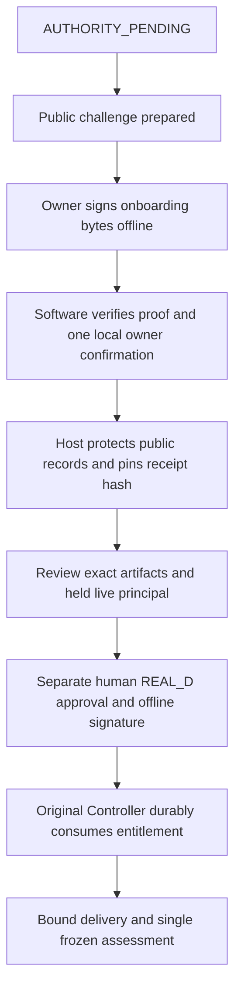

# Single-owner authority and release boundary

Mission `P12-REAL-D-SINGLE-APPROVER-AMEND-1`, base `6e952aeb0bc19abead5b208327b56298f25dc290`. This document explains the already registered protocol; it changes no state, scientific definition, test oracle or release permission. The frozen source and the two signed security amendments govern implementation.

The project owner controls the genuine Ed25519 private key on a physically separate offline signing device. Codex and the analysis worker receive public records only. The trusted Windows Host verifies those records and protects the public trust root; it is a trusted local administrative role, not an independent third-party custodian. A malicious administrator and remotely provable physical key isolation are outside the established protection.

No genuine owner ceremony is supplied in this mission. REAL authority remains at the first state. The public pending dossier cannot stand in for the reviewed canonical approval body. Its missing live principal, protected owner receipt and canonical body remain explicitly null. No REAL entitlement, release or assessment is created by public preparation.

Public-key admission first checks the exact raw 32-byte encoding, canonical field/sign representation, curve equation, nonidentity and exact prime-subgroup membership. Signature verification then proves possession of that admissible public key over the exact canonical onboarding bytes. Challenge, proof, confirmation and receipt bind the owner designation, ceremony and nonce, realm, mission/base, setup statement and both security-policy hashes. Receipt hashes and exact schemas prevent substituting unrelated public records. The onboarding purpose is rejected as a Controller release approval.

One local confirmation acknowledges the owner's setup statement. Automatic SHA256 operates on decoded public-key bytes; no second human or manual fingerprint comparison is required. The statement and possession proof do not remotely establish physical separation. Creating a key accessible to Codex, using a synthetic key or asserting a directory name would fail the actual owner-controlled setup requirement.

The frozen production broker verifies the protected deployment hash, authority receipt, exact code/runtime and held Windows process identity before activation. Restricted target/controller roles have zero AppContainer capabilities. Actual synthetic role tests must show source/key/issuer access, ACL regrant, network and Host-memory denials, plus the target's protected-ledger denial. The controller can write its explicitly assigned ledger. These tests establish the tested Windows boundaries; they do not establish protection against the trusted Host administrator.

The original durable Controller, append-only records and independent fence remain byte-identical. Consumption precedes decryption. Duplicate/concurrent/replayed requests and tampering are denied, and interruption does not restore an entitlement. Producer fault tests distinguish actual child-process crashes from Host exception injections. A synthetic interruption after ACL grant can expose synthetic delivery capability even though no evaluation start signal or valid completion exists; it is never reported as zero exposure.

All synthetic authorities, signatures, ciphertext, ledgers and evaluation outputs belong to new append-only SYN namespaces. Interrupted attempt 1 remains consumed and preserved. Corrected attempt 2 has its own namespace, source freeze, reviews and receipts. Neither namespace can constitute genuine owner provisioning, REAL_D release, biological evidence or retrospective clearance of historical M4 failures.
