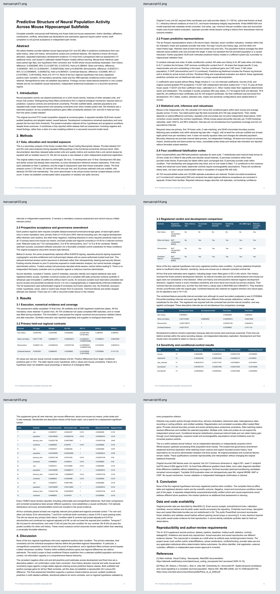
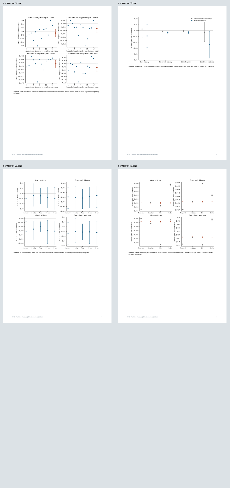
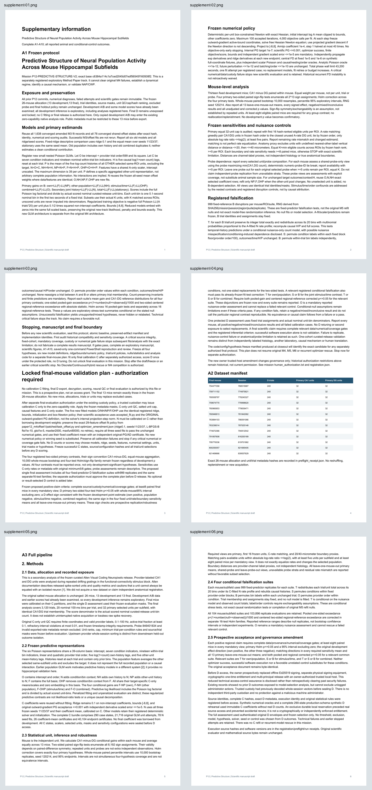
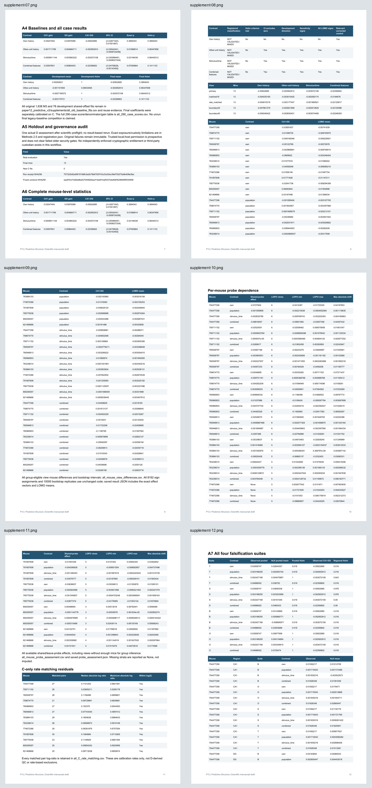
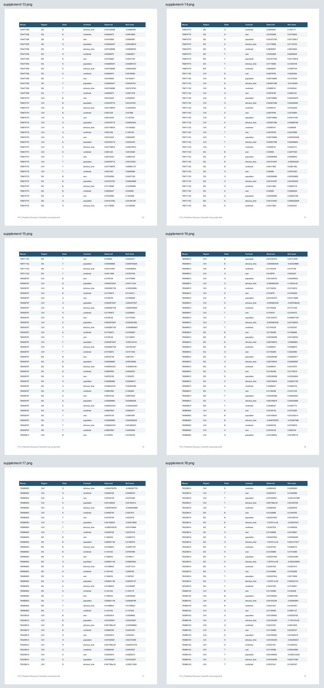
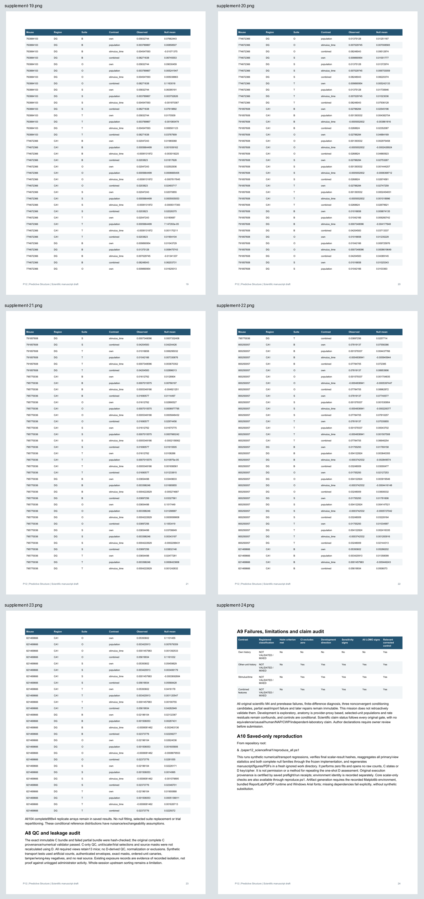
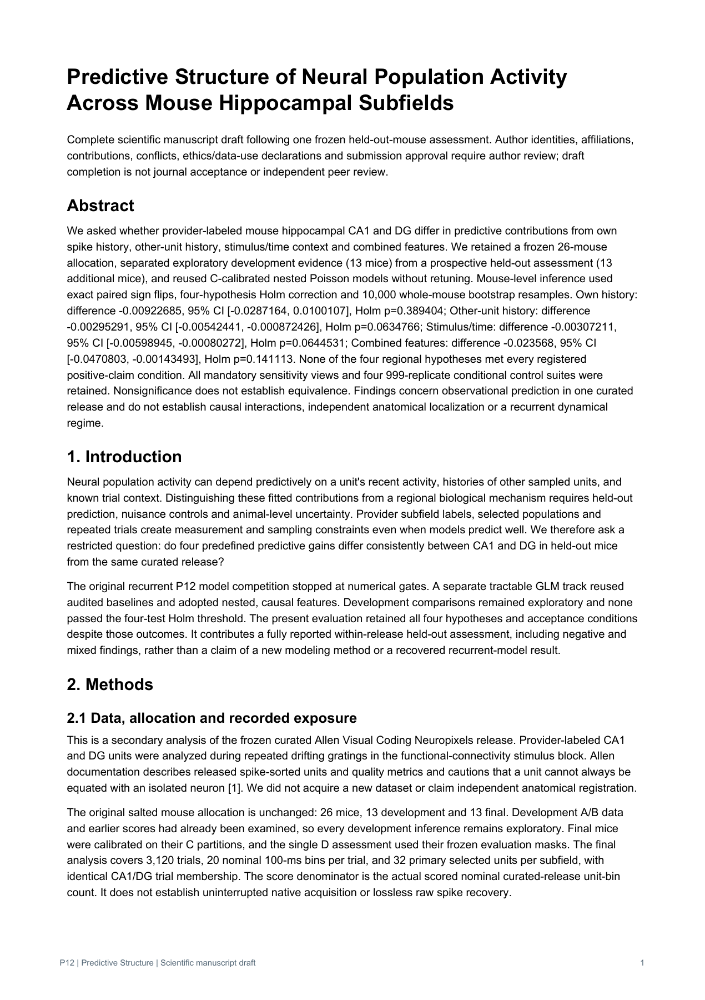
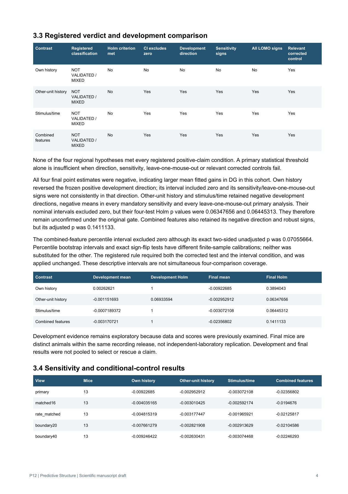
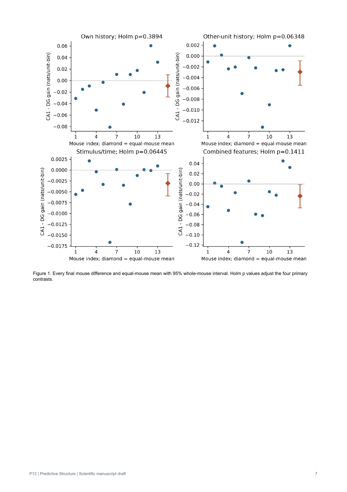
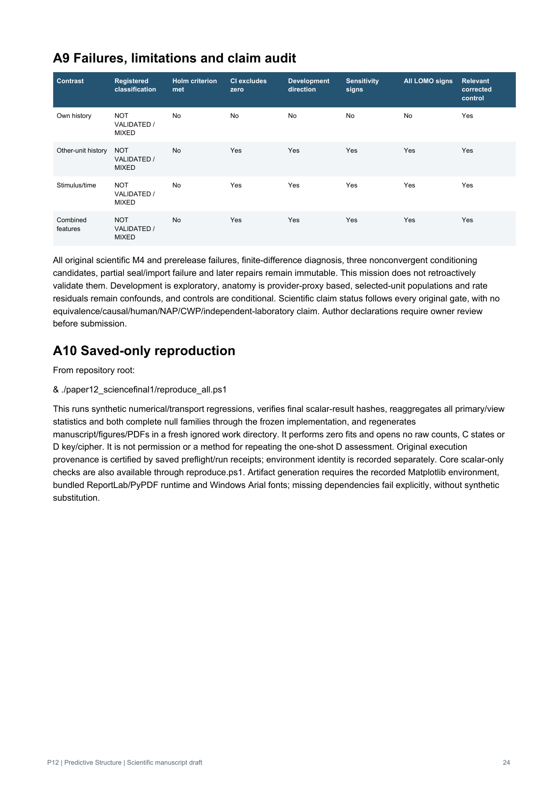

# Final PDF visual QA gallery

34/34 pages rendered after heading fix. Six contact sheets cover every page; selected full-page captures verify text, verdict matrix, effects and final supplement sections. Paper source and scientific results unchanged by layout fix.

