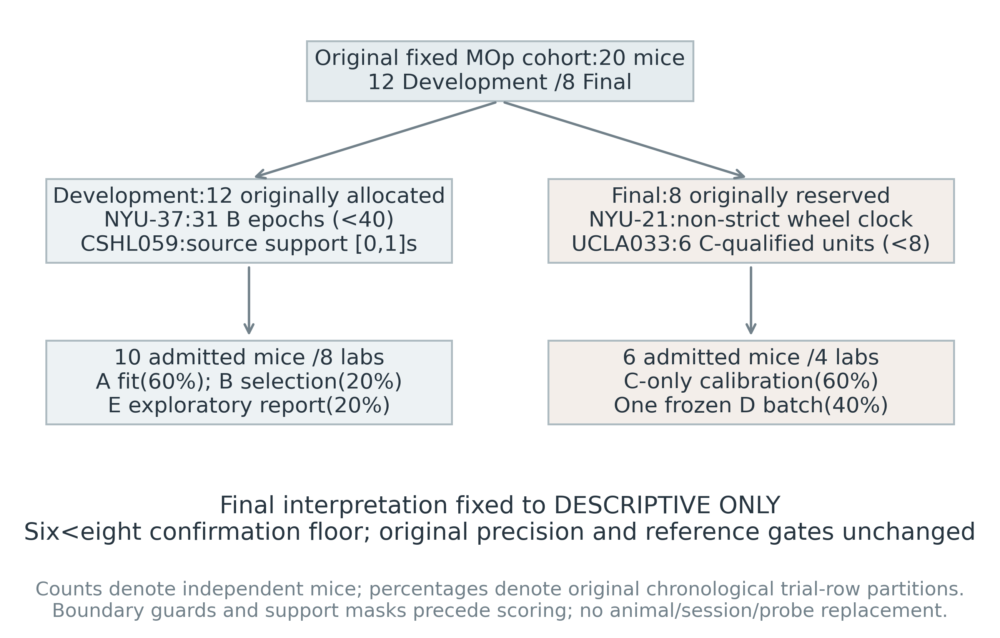

# Predictive Contributions of Local Spike History in Mouse Primary Motor Cortex: A Development and Independent-Animal Descriptive Evaluation

**Authors:** [Author names and contributions to be supplied by the scientific authors]

**Affiliations:** [Verified affiliations to be supplied by the authors]

**Correspondence:** [Author-controlled contact to be supplied]

Article type: methods-oriented empirical secondary analysis. Results-locked manuscript for author review; not a record of external peer review or publication acceptance.

## Abstract

Local spike history can improve neural prediction while reflecting task timing, movement, firing-rate structure, or shared inputs rather than a distinct biological mechanism. We evaluated its predictive contribution in public International Brain Laboratory mouse primary motor cortex recordings using a frozen, strictly past feature pipeline. Twenty mice were allocated to Development (12) or reserved Final evaluation (8), with one session and probe per mouse. Source and training-only physiological screens admitted 10 Development mice from eight laboratories and six Final mice from four laboratories. Poisson models compared task, stimulus, wheel and drift nuisances with own-unit and other-unit spike history. Compact conditional hidden Markov, continuous-history and static-mixture representations provided additional comparisons. Development selection was frozen before one independent-animal Final assessment. Combined history improved prediction over the nuisance baseline by 0.112529 nats per nominal curated-release unit-bin in Development (95% whole-mouse interval 0.067458 to 0.163682) and 0.086582 in Final (0.049440 to 0.141102; one-sided raw sign-flip p=0.015625); all six Final effects were positive. Nevertheless, Final interpretation is **DESCRIPTIVE ONLY**: the eight-mouse confirmation floor and 0.01 interval-width requirement were unmet. All five secondary Holm-adjusted comparisons were nonsignificant. Development temporal-disruption evidence was mixed, and the order/drift reference lacked aggregate coverage in both cohorts. These observations support a descriptive predictive contribution of local history under measured nuisance controls, without establishing causal connectivity, compact-model superiority or persistent biological states. All negative findings, unavailable controls and the earlier native-timestamp correction are retained.

## 1. Introduction

Neural populations contain temporal dependencies at several scales. A neuron's recent firing can reflect refractoriness, adaptation, ongoing excitability or unobserved input. Activity in neighboring units can supply additional predictive information. Those statistical relationships are useful for forecasting counts but do not, by themselves, identify interactions or the biological source of a shared signal. Point-process models provide a way to express spike history and measured external covariates within one likelihood [3,4]. Their relevance here is as explicit predictive comparisons, rather than as a route from fitted coefficients to causal connectivity.

Separating local neural history from task and movement information is particularly important in motor cortex. Task events and wheel actions have structured timing, and behavior includes movements that a wheel does not measure. Prior work demonstrates the importance of diverse movements for interpreting neural variation [9]. A history model compared only with a stationary firing rate could absorb predictable task or movement structure. A demanding comparison therefore includes event-gated stimulus information, strictly past wheel measurements, trial/session drift and unit-specific intercepts before adding local spike history.

Public, standardized multi-laboratory recordings make this comparison possible while introducing their own constraints. The International Brain Laboratory (IBL) Brain Wide Map provides recordings collected during a visual decision task [1,2]. The present analysis uses a small, prospectively selected MOp subset of the native public release. It does not reproduce the original brain-wide study or inherit that study's population coverage. Laboratory heterogeneity, native source revisions, upstream unit curation and incomplete movement measurements remain relevant to this secondary analysis.

The primary question was whether combined own-unit and other-unit history improved held-out count prediction beyond a strong nuisance model. Five secondary contrasts separated the two history contributions and tested compact discrete and continuous representations. A static mixture with at least the selected discrete model's nominal parameter count was included to guard against attributing any mixture benefit to temporal persistence. Such a guard cannot equate effective model capacity, but it makes a temporal interpretation more demanding than a comparison with a single Poisson predictor alone.

The study followed a staged, source-first design. Development data supported model selection and exploratory reporting; reserved animals supported a single later assessment under frozen policies. The protocol explicitly allowed six or seven admitted Final animals only as a descriptive fallback. Six were admitted. Consequently, the contribution of this paper is a complete, reproducible predictive comparison with transparent negative and mixed findings, not fulfillment of the original confirmation criteria. The main text reports the failed criteria and controls alongside the positive descriptive primary mean.

## 2. Methods

### 2.1 Public source, provenance and anatomical scope

We used the native IBL Brain Wide Map public AWS release, supplied by the International Brain Laboratory under CC BY 4.0 [10-12]. The global source inventory contains 139 mice, 459 sessions and 699 probe insertions; these are source denominators, not the analyzed MOp cohort. The eligibility screen used the paired `2024_Q2_IBL_et_al_BWM` aggregate metadata and `2023_12_bwm_release` insertion roster. Neural analysis used exact pinned native files: spike sorting `pykilosort/#2024-05-06#`, trial tables `#2025-03-03#`, and UUID/ETag/size-pinned wheel, sync, header, channel-mapping and saturation files. No DANDI-derived source version or licence was substituted. The source provider's derived files were not re-sorted or re-extracted in this study.

The fixed anatomical target was MOp, including its parent and layer suffixes 1, 2/3, 4, 5, 6a and 6b. MOs and somatosensory regions were not pooled into the population. Cluster anatomy was resolved through the native cluster-to-channel mapping and channel atlas labels. One specified probe and session were used per mouse; no cross-probe, cross-session or cross-animal population was assembled. Supplement S1-S3 and the source manifest retain original identifiers and native annotation differences. The boundary sensitivity uses neighboring contact indices as a proxy, not measured histological distance.

### 2.2 Allocation, attrition and chronological roles

Twenty original candidate mice were fixed as 12 Development and eight Final animals (Figure 1). Two feasibility-pilot mice remained in Development. Development admission required at least eight mice across four laboratories, eight qualified units and at least 80 training-A, 40 selection-B and 40 report-E epochs per mouse. Ten mice from eight laboratories were admitted. NYU-37 had only 31 B epochs; CSHL059's supplied sync domain [0,1] seconds yielded no covered epochs. Neither was replaced or extrapolated.

The eight reserved Final identities were unchanged. NYU-21 failed the native wheel strict-order source screen: 16,485 adjacent timestamp pairs were equal. No deduplication or timing repair was applied. UCLA033 passed source preparation but had six C-qualified units, below the frozen eight-unit minimum, and was excluded before calibration-model fitting and D scoring. The remaining six mice came from four laboratories, with laboratory counts 1, 2, 2 and 1. The pre-existing six-to-seven-mouse rule required **DESCRIPTIVE ONLY** interpretation, independently of observed p-values. Final source and unit admission used metadata and C, not D outcomes.

Chronological cuts were defined on original native trial rows before exclusions. Development used A=first 60%, B=next 20%, E=last 20%; Final used C=first 60% and D=remaining 40%. Cuts used floor rounding. The last original trial before and first trial after each boundary were removed from adjoining roles. Invalid trials did not cause partition boundaries to move. Development B selected global configurations; E remained an exploratory report. Final C supplied new calibration coefficients and preprocessing; the consumed D batch supplied the independent-animal descriptive report. These roles are chronological partitions, not randomly exchangeable trials.

### 2.3 Observation support, physiology and exact native timing

The primary analysis used 50-ms bins, eight units and stimulus-aligned epochs comprising 0.5 s neural warm-up followed by 0.5 s scored exposure. Each epoch had ten warm-up and ten score bins. The complete epoch had to lie inside the trial, source recording support and non-extrapolated sync domain, with finite ordered task events and no known saturation overlap. Missing support was excluded rather than represented as zero firing. Wheel predictors additionally required 0.5 s preceding the neural warm-up. Epochs did not overlap; neural histories and latent filters reset at each epoch, with no carry-over across trials or gaps.

The source's provider-good label and native MOp annotation are upstream whole-session curation, not newly computed training-only QC. New physiology used A or C valid warm-up-plus-score exposure only: rate 0.5-100 Hz, at least 100 spikes, within-epoch ISI fraction below 1 ms at most 0.005, and at least 99 adjacent within-epoch ISI pairs. Each original training/calibration quartile required at least 10 s exposure and rate at least 0.1 Hz. No ISI crossed an epoch gap. Qualified units were ranked by ascending refractory fraction, descending A/C rate, then UUID; the first eight formed the primary population. This rule favors well-observed units and does not represent all local neurons.

Native binary64 event values, missing-side stimulus semantics and strict predecessor comparisons were preserved. The original Development execution had serialized native timing to ten decimal places, altering strictly past wheel features in five of ten mice. It stopped as a source-implementation failure. A separately authorized corrective Development execution used exact-native values and independently audited source/feature correspondence. The 358 completed numerical fits and one interrupted start from the earlier execution remain historical evidence and were not reused or retrospectively made scientifically valid. The correction is methodological provenance, not a new model or a result-driven tuning step (Supplement S4).

### 2.4 Strictly past predictors and nuisance baselines

Every time-dependent input had to be available strictly before the predicted bin start. Events exactly at that boundary entered only subsequent bins. The 37 nuisance columns comprised trial elapsed-time terms, observed stimulus contrast and side terms, event-gated go-cue/response/choice/feedback terms, previously completed-trial codes, original trial ordinal and session-time drift, and backward-held wheel position/displacement/variation terms over four past windows. Current choice and feedback were unavailable before their observed event times. No future smoothing or first-movement variable was included. The full column definitions are reproduced in Supplement S5.

Own-unit and other-unit neural features were rates in four disjoint past windows: 0-50, 50-100, 100-200 and 200-500 ms. Histories outside the reset epoch were zero. Their observed score-bin histories followed the warm-up. Nuisance/history means and standard deviations were estimated on A/C score rows only, then persisted; standardized ordinary predictor values were clipped to [-3,3]. Constant columns had fixed zero coefficients. The continuous model's intermediate standardized microbin rates were not clipped; its resulting state had its own A/C scaling and clipping. All compared models shared unit order and observation masks.

For unit u and bin t, the count model used a Poisson mean with explicit exposure:

$$\mu_{tu}=\Delta\exp(\eta_{tu}),\qquad \ell_{tu}=y_{tu}\log\mu_{tu}-\mu_{tu}-\log(y_{tu}!).$$

B0 contained unit intercepts. B1 added nuisance predictors. B2 added own history to B1; B3 added other-unit history; B4 included both. The feature spaces are mathematically nested, although separately selected penalties mean fitted held-out scores need not be monotonic. At eight units, nominal parameter counts were 8, 304, 336, 528 and 560. Actual active counts were smaller when columns were constant. Unit intercepts account for baseline rate differences; they do not remove all rate-related or unmeasured behavioral confounding.

### 2.5 Compact discrete, continuous and static representations

The discrete model D was a conditional Poisson hidden Markov model with a B4 predictor plus state-dependent unit offsets. Transition and initial probabilities were softmax parameterizations with reference gauges; the reference state's offset was zero. Pre-bin state weights generated the joint count likelihood, after which the observed bin updated the causal filter. The same recursion processed warm-up bins without adding their likelihood to the scored objective. Derivatives included the warm-up filtering path. Conditional score likelihood equaled full-epoch likelihood minus warm-up likelihood. No current-bin posterior or smoothed state was used to predict that same bin. This follows a forward-filtering construction [5], adapted to the frozen conditional Poisson model.

The continuous-history model C added a fixed low-rank DCT projection of the ten past 50-ms microbin rates, weighted by a truncated exponential kernel. Its projection depended on frozen unit order, with no learned PCA or selected favorable projection. State coefficients were fitted, but the feature dynamics themselves were deterministic given past observed counts. C was not a learned recurrent network or an autonomous count generator. Its selected rank-one, 0.1-s kernel added eight parameters to B4, for 568 nominal parameters.

The static mixture S used the same B4 emissions, offset gauges and mixture-logit penalties but independent latent draws at every bin, with no transition persistence. The selected D had three states and 584 nominal parameters; its prescribed static comparator had four components and 587. This is a nominal-capacity guard, not equality of effective flexibility. D and S each retained all three frozen seed fits. Prediction uniformly mixed their pre-bin joint masses, with separate causal HMM filters, rather than averaging label-dependent coefficients. The ensemble also differs in effective capacity from a single fitted baseline.

### 2.6 Development selection, numerical policy and Final calibration

Development searched ridge values 0.01, 0.1 and 1; D state counts 2/3; C ranks 1/2 and time constants 0.1/0.25 s; and S components 3/4. D/S used seeds 11, 23 and 37. Each family selected one global policy by equal-mouse B log likelihood per unit-bin, with the frozen tie rule and S size paired to the selected D. No E-driven choice or A+B refit was made. Selected ridges were B1/B2=0.01, B3=1, B4=0.1, C=0.1 and D/S=0.01. D selected three states, C rank one with 0.1-s history weighting, and S four components.

Training minimized negative score likelihood divided by the number T of population score bins, plus ridge on all non-intercept free coefficients. T is not T times the unit count. Evaluation gains nevertheless used the actual scored unit-bin denominator. Bounds were [-8,8] for intercepts, [-1,1] for linear coefficients, [-2,2] for state offsets and [-4,4] for free logits. B0 used its constrained closed-form optimum. Other fits used float64 L-BFGS-B with maxiter 2,000, maxfun 80,000, maxls 40, ftol 1e-12 and gtol 1e-6, without retries or output-rate clipping. Acceptance required the original outward-gradient projected-gradient norm at most 0.001, independent endpoint AD error at most 1e-5, and every fixed finite-difference step (1e-4, 1e-5, 1e-6) at most 1e-5. A solver success flag alone was insufficient. The stricter synthetic analytic/AD criterion was 1e-8.

Corrective Development completed 610 main and 525 sensitivity starts. Final C fitted the exact global policies anew, initialized from each mouse's own C rates without Development coefficient reuse: 72 main and 320 sensitivity fits all passed. Complete coefficients, scalers, active maps, units, trial masks and case configurations were sealed before D. Historical 359 plus corrective 1,135 plus Final 392 gives 1,886 starts. The separately authorized corrective budgets and Final caps are disclosed; the original aggregate ceiling is not retrospectively rewritten (Supplement S7-S8).

### 2.7 Independent pre-D approval and one-shot assessment

The Final C reader used separately explicit authorization for low-level whole-record ALF decoding solely to classify/export C. Calibration roles received C-only exports, and no pre-D D neural QC, scales, selected units or random streams were used. This was an ordinary local scientific access boundary, not cryptographic custody or protection against a malicious administrator. Independent pre-D scientific and numerical reviews bound a 546-input candidate and the complete C seal. The scientific review explicitly withheld confirmation under the six-mouse scope and unresolved sampling/sign-symmetry assumptions.

Exactly one frozen D batch produced the primary, five secondary, eleven baseline-sensitivity and four finite-reference outputs. No D model fit, model replacement, surrogate replacement or later reassessment occurred. Reference transformations were part of this single batch. The present manuscript mission reads only saved outcomes and evidence, with no neural prediction worker or D array loading. Saved arithmetic reproduction is distinct from independently rerunning all raw-data fits.

### 2.8 Animal-level estimands, uncertainty and multiplicity

The primary mouse effect and equal-mouse estimand were:

$$d_m=\frac{LL_{B4,m}-LL_{B1,m}}{Q_m},\qquad \bar d=\frac{1}{n}\sum_{m=1}^{n}d_m,\qquad Q_m=T_mU_m.$$

Here Q is each mouse's actual valid scored nominal curated-release unit-bin count; factorial and exposure terms were retained. Mice, not units or trials, had equal inferential weight. Five secondary contrasts, in registered order, were own history B4-B3, other-unit history B4-B2, D-B4, C-B4 and D-S. Positive values favor the first model. The primary exhaustive sign-flip test was one-sided; secondaries were two-sided and retained their fixed five-slot Holm family [6]. Unavailable comparisons retain p=1 rather than disappearing.

Exhaustive enumeration is exact computation on the sign grid, but its inferential interpretation requires independent, sign-exchangeable symmetric zero-centered mouse effects at the null boundary [7]. It is not an assumption-free test of any arbitrary population mean. Shared laboratories and a convenience cohort leave those assumptions uncertain. No D-based assumption pretest selected a different method. Intervals used 10,000 whole-mouse bootstrap draws, PCG64 seed 150101 and linear percentile quantiles [8]. Equal-lab, leave-one-mouse/lab-out and four-lab block-bootstrap outputs were dependence diagnostics, not independent-laboratory replication.

At n=6, there are 64 sign assignments. Minimum one-sided and two-sided p-values are 1/64=0.015625 and 2/64=0.03125. Therefore the smallest possible five-test Holm-adjusted secondary p-value is 5 times 0.03125=0.15625. This discrete resolution limitation was documented before D. It does not imply equivalence or calculate empirical power. The primary positive-claim rule also required eight mice, at least four laboratories, defensible assumptions, gain at least 0.001, a positive interval lower bound, interval width at most 0.01, specified sign/leave-out stability, mandatory sensitivity coverage and N1/N2 disruption conditions. None was relaxed for reporting.

### 2.9 Sensitivities and finite references

Eleven prespecified sensitivity cases refitted B0-B4 only: 5/12/20 units, 100-ms bins, 250-ms history, stricter physiological QC, C/A-rate-defined spike thinning, known-saturation dilation by 10/50 ms, richer trial/session drift and a five-unit contact-neighborhood boundary proxy. No D/C/S sensitivity refit was registered or performed. S04's per-100-ms-bin scale differs from the primary 50-ms scale. S07 used one independent role-local PCG64 stream per unit; A/C rates set retention probabilities, with no score-driven reranking or repetition.

Four suites each specified 999 reference realizations per available mouse. N1 rotated each epoch's multivariate count sequence; N2 exchanged history donors within coarse stimulus/contrast/order/wheel strata; N3 substituted wheel donors and reported B4-likelihood reliance; N4 shifted complete five-trial history blocks. Targets, nuisance definitions, fitted states and exposure rules remained fixed. N2-N4 required at least 60% eligible-epoch coverage and 30 control epochs. N4 additionally required complete blocks. Singleton/incomplete coverage was not rescued by coarsening.

These destructive references alter alignment and are not exact causal or mechanistic conditional-null draws. N1/N2 descriptive gates required at least six paired mice, at least 75% above their within-mouse reference median, and positive equal-mouse mean degradation. Four-suite reference p-values used the original plus-one rule and per-contrast Holm4 reporting. The p-values do not replace the mouse-level tests or imply population-null validity. N3 is a wheel-related B4 likelihood diagnostic, not an independent wheel-null assessment of D/C and not control for all movements. Supplement S10-S12 retains every failed and unavailable panel.

## 3. Results

### 3.1 Cohort and numerical feasibility

The original allocation yielded 10 Development and six Final admitted mice, without replacement (Figure 1; Supplement S1). Eight primary units were selected per admitted mouse from the fixed probe. Thus the primary analysis used 80 Development and 48 Final nominal curated-release units, with mouse as the independent unit. Those counts describe selected release units, not complete local cell populations or independent statistical samples. The six Final mice contributed 1,360 valid scored epochs and 108,800 primary unit-bins.

All 72 Final main and 320 applicable sensitivity fits passed the frozen numerical gates without retry. Of 66 mouse-by-sensitivity states, 64 were available. The two unavailable states were the 20-unit case for NR_0027 and DY_011; both had only 17 C-qualified units. The 12-unit case was available in all six mice. Full saved endpoint certificates, free-parameter counts, projected gradients, independent AD/FD errors and termination records are retained in Supplement S8 and the accompanying tables. These engineering successes do not imply that scientific positive-claim criteria were met.

### 3.2 Combined history gains across separate cohorts

Development B4-B1 had equal-mouse mean 0.1125291851306621 nats per actual scored nominal curated-release unit-bin, with 95% interval [0.06745810552609997, 0.16368155129436163] and one-sided raw p=0.0009765625. This is exploratory Development evidence after B selection, not a fresh animal holdout. Its precision and N1 disruption conditions failed, as detailed below.

The independent-animal Final mean was 0.08658239652342035, with interval [0.04944033234175033, 0.14110164811873427] and one-sided raw p=0.015625 (Figure 2; Table 1). All six mouse effects were positive, ranging from 0.0350064985 to 0.2151141990. Final and Development means had the same descriptive direction, but no pooled estimate or new Development-Final difference test was performed. The cohorts remained separate throughout reporting.

The Final result is **DESCRIPTIVE ONLY**. Its interval width was 0.09166131577698394, exceeding the frozen 0.01 requirement; six mice were fewer than the eight required for confirmation, and the test's sampling assumptions were not established. A positive interval and small conditional p-value cannot override those restrictions. No robust confirmation or causal identification is inferred.

### 3.3 Own-unit and other-unit history

Final own-history B4-B3 had mean 0.05208972400526927 and interval [0.03441612054329819, 0.07346442266178636], with raw two-sided p=0.03125 and Holm5 p=0.15625. Final other-unit history B4-B2 had mean 0.006353386392021677, interval [-0.008903428833930957, 0.022405637931404047], raw p=0.53125 and Holm5 p=1. All six own-history effects and five of six other-unit effects were positive. These are conditional predictive ablations with separately fitted, penalized models. Their magnitudes are neither a partition of causal influence nor a new statistical test that own history exceeds other history (Figure 4).

Development own-history and other-unit means were 0.03930120524139896 and 0.026306579812766885, respectively. Their Holm5 p-values were 0.05859375 and 0.1796875. Thus the development-to-Final pattern was mixed in magnitude: own-history mean increased and other-unit mean decreased descriptively. No post hoc pooled contrast or explanation of that difference was tested. All five registered secondary comparisons in each cohort remained nonsignificant after correction.

### 3.4 Compact representations and the static-mixture guard

Final D-B4 averaged 0.00235862122254638 (interval [-0.003948272203674794, 0.009196280435455508]; raw p=0.53125, Holm5 p=1). C-B4 averaged 0.00013410738971923112 ([-0.00005783408566630739, 0.00034291798308512485]; raw p=0.28125, Holm5 p=1). D-S averaged 0.0016697806796088692 ([-0.00030445108225563776, 0.0051111034674382804]; raw p=0.5625, Holm5 p=1). Only three Final D-B4 mouse effects and two D-S effects were positive. No discrete or continuous superiority was established.

The selected discrete model's Development D-B4 mean was negative, -0.01477973215700219, whereas its Final descriptive mean was positive. D-S was also negative in Development (-0.0019684110379102277). These changes in descriptive sign do not establish a biological transition, cross-cohort difference or recovered temporal mechanism. C-B4 was small in both cohorts. The static guard and absent N4 aggregate further restrict persistent-state language, even independently of the nonsignificant model comparisons.

Table 1 reports all Final comparisons in the originally registered order. Primary p is one-sided; the five secondary p-values are two-sided and corrected together. Intervals are 95% whole-mouse percentile intervals, n=6 for every row; gains use 50-ms bins and actual scored nominal curated-release unit-bin denominators.

|Contrast|Mean gain|95% whole-mouse CI|Raw p|Holm5 p|
|---|---|---|---|---|
|B4-B1|0.08658239652342035|[0.04944033234175033, 0.14110164811873427]|0.015625|not in family|
|B4-B3|0.05208972400526927|[0.03441612054329819, 0.07346442266178636]|0.03125|0.15625|
|B4-B2|0.006353386392021677|[-0.008903428833930957, 0.022405637931404047]|0.53125|1.0|
|D-B4|0.00235862122254638|[-0.003948272203674794, 0.009196280435455508]|0.53125|1.0|
|C-B4|0.00013410738971923112|[-5.783408566630739e-05, 0.00034291798308512485]|0.28125|1.0|
|D-S|0.0016697806796088692|[-0.00030445108225563776, 0.0051111034674382804]|0.5625|1.0|

### 3.5 Falsification, unavailable coverage and sensitivities

Development primary N1 had only 7/10 mice above their own reference median, below the frozen 8/10 requirement. Its positive average degradation and Holm4 reference p=0.004 did not clear that failed descriptive condition. Development N2 met its descriptive gate with 10/10. Final primary N1 and N2 each met the descriptive condition with 6/6 mice above the median and positive mean degradation, with Holm4 reference p=0.004 for each. Final successes do not erase Development's failure or override the six-mouse, precision and assumption restrictions (Figure 5).

N4 lacked minimum-six aggregate coverage in both cohorts: five Development and three Final mice qualified. Eligible per-mouse references were retained, but aggregate N4 remained unavailable with its fixed p=1 slot. In Final, D-B4 failed the N2 descriptive disruption condition (4/6 above the median and negative mean degradation). D-S failed N1 (4/6, below the required five) and N2 (2/6 and negative degradation). A small reference p alone did not rescue a failed multi-part descriptive gate. N3 quantified measured-wheel reliance of B4, not independence of local history from all movement.

All eleven sensitivity cases and all unavailable panels are reported (Figure 6; Supplement S10). The nine mandatory baseline cases retained positive primary, own-history and other-unit mean gains with at least six Final mice. The 12-unit case also had six mice; the 20-unit case had only four and was unavailable for the original minimum-six comparison. The 100-ms case changes the unit-bin timescale; its larger per-bin values cannot be compared with 50-ms gains as equal rates. Rate thinning was defined from C/A, not matched retrospectively using D. These results describe B0-B4 sensitivity refits only. They supply no D/C/S sensitivity robustness evidence and do not recover a failed primary confirmation condition.

### 3.6 Animal, laboratory and anatomical heterogeneity

Final primary gains were heterogeneous: median 0.0649280767, SD 0.0660187526 and range 0.0350064985-0.2151141990. The largest value belonged to ZFM-01576. Its magnitude illustrates why the equal-mouse mean should be accompanied by individual effects and why a positive group mean is not a uniform effect-size claim. The primary equal-lab diagnostic mean was 0.0807039980. Every primary leave-one-mouse and leave-one-lab mean remained positive; the four-lab block-bootstrap diagnostic interval was [0.0490376505, 0.1182105758]. These checks show the descriptive sign's stability under those omissions, without increasing the effective number of laboratories or satisfying the failed precision rule.

Native atlas composition varied across selected populations (Figure 7). Superficial, middle, deep and root/unknown labels were retained separately rather than relabeled to improve a pattern. Native depth was unavailable in the frozen metadata. Boundary-neighborhood eligibility and layer fractions are source-derived proxies with uncertainty from sorting, channel mapping and registration. Saved associations are descriptive; no anatomical mechanism or additional layer hypothesis was tested. Laboratory, mouse, unit and source-summary tables accompany the supplement.

## 4. Discussion

### 4.1 What the descriptive predictive increment supports

The combined-history model achieved a positive average held-out increment over the nuisance model in both cohorts, including positive effects in all six Final mice. The baseline already contained observed task events, stimulus contrasts, strictly past wheel information, unit intercepts and chronological drift. The result therefore describes predictive information in local recent spiking beyond those particular measured features, transformations, fitted penalties and masks. Its scope is eight ranked curated-release MOp units at a 50-ms observation scale over stimulus-aligned half-second score windows.

That operational result is useful even without a positive confirmation label. It identifies a concrete baseline that compact representations must improve on and provides animal-level effect sizes for future designs. It also shows why a stationary-rate comparator alone would be insufficient for the primary question. At the same time, favorable prediction cannot determine whether the added information arose from intrinsic dynamics, shared input, unmeasured movement, sorting structure or an incomplete nuisance model. Strictly past indexing prevents direct current/future-bin leakage; it does not establish a causal mechanism or an intervention-ready online predictor.

The own-history comparison had a positive descriptive Final interval, whereas the other-unit interval crossed zero. Both retained nonsignificant Holm-adjusted tests. Because the five-test family cannot reach 0.05 at n=6 under this exact sign-flip design, the lack of adjusted significance is partly a fixed resolution limitation. It is not a licence to discard correction, choose another test, declare the five effects absent or convert conditional ablations into causal attribution. A new cohort would be needed for an adequately specified confirmatory assessment.

### 4.2 Compact representations did not earn stronger claims

The discrete and continuous models were deliberately compact and shared a strong B4 predictor. The continuous representation added a deterministic projection of observed past rates, while the discrete model introduced a filtered mixture of conditional emissions. Their small Final mean increments and crossing-zero intervals did not establish superior prediction. The contrast with a larger static mixture was also mixed across mice. Neither more temporal machinery nor the model names demonstrate persistent biological states.

The D/S guard has limits. Counting nominal parameters does not equalize regularization geometry, optimization, ensemble capacity or functional flexibility. S has more emission components, D has transitions, and both ensemble three starts. The comparison tests this frozen pair, not every static or dynamical family. No broad statement that continuous or discrete models are useless follows from this restricted negative result. Conversely, the positive Final mean D-B4 after a negative Development mean cannot justify selecting Final as the preferred story or rescuing the original dynamical interpretation.

### 4.3 Development and Final evidence have different roles

Development data supported source feasibility, global selection and exploratory E reporting. Two pilot mice were already exposed before the scientific development stage. Exact-native correction repaired a demonstrated serialization problem prospectively; it did not transform Development into unexposed evidence. Final animals were separate identities, but attrition left only six. They support an independent-animal descriptive evaluation under the original fallback, not independent-laboratory replication or an eight-mouse confirmation.

The primary descriptive direction was similar across cohorts, while conditional components and the D-B4 sign differed. These observations may motivate a future study but were not subjected to an added cross-cohort test. Reporting all six effects, interval widths and reference failures is necessary to avoid presenting only the favorable repeated direction. The inability of N4 to support an aggregate result in either cohort is especially relevant to any drift-independent or persistent-state account. A control with inadequate coverage is missing evidence, not a null finding or a successful falsification.

### 4.4 Movement, source and sampling limitations

Wheel position and history are useful measured nuisances, but behavior is richer than wheel motion [9]. No face, whisker, pupil, licking or whole-body trace was established as complete for this analysis. N3 changes measured wheel alignment; it cannot demonstrate all-movement independence. N2 uses coarse nuisance strata and can leave continuous imbalance. N1 and N4 also disturb neural/task alignment. Their finite references therefore diagnose reliance on specified structure, subject to assumptions, rather than isolate a biological cause.

Upstream sorting and anatomy are release curation, and known saturation masks do not certify absence of other artifacts or lossless recording. Ranking eight qualified units favors stable, observed units and limits population-size generalization. Layer annotations and neighboring contact indices are imperfect proxies, with no saved native-depth measurement. Source revisions required exact identities and clocks; the earlier decimal-serialization failure illustrates how a seemingly small representation choice can change a causal predecessor feature. Preserving that failure and its unused fits is part of the result's auditability.

### 4.5 Precision, dependence and future work

Six mice and four laboratories provide limited precision and do not establish independent, symmetric mouse-effect sampling. Bootstrapping mice respects the registered inferential unit, but its interval is conditional on this small selected cohort. Lab omission and block-bootstrap diagnostics do not repair that sampling limitation. The interval width failed its original requirement even though its lower bound was positive. That failure is substantive to the scientific claim and remains explicit in the abstract, results and conclusion.

Future confirmation would require a newly registered independent cohort, adequate animal and laboratory representation, prospectively adequate reference coverage and a justified uncertainty design. Richer behavioral measurements and better anatomical validation could address specific residual confounds. Such work would constitute new science. The consumed Final D cannot be reused to choose models, improve power, revise masks or search for a favorable control. The present package instead preserves a complete account of what the fixed study measured and where its original claim conditions failed.

## 5. Limitations

The Final sample did not meet the eight-mouse confirmation floor; the primary interval width exceeded 0.01. Inferential sign symmetry and mouse independence were not established, and laboratory dependence remained possible. Development evidence was exploratory and included exposed pilots and a separately authorized correction. Its primary temporal-disruption condition failed. N4 aggregate coverage was unavailable in both cohorts; Final D-B4 and D-S had additional failed disruption conditions. All five secondary corrected tests were nonsignificant, with a known n=6 resolution floor, and none establishes equivalence. Baseline-only sensitivities cannot support D/C/S robustness. Eight selected release units, limited recording windows, wheel-only movement measurement, upstream sorting/anatomy and incomplete artifact annotation restrict generalization. No causal connectivity, motor-command mechanism, persistent biological state, independent-laboratory replication, human/BCI validation or general CWP/NAP claim is supported.

## 6. Conclusion

Under a frozen strictly past pipeline, combined local MOp spike history provided a positive descriptive predictive increment beyond measured task, wheel and drift nuisances in Development and six independent Final animals. Compact discrete and continuous representations did not establish superiority over the combined history baseline or the prescribed static guard. The Final scientific verdict is **DESCRIPTIVE ONLY**, with failed cohort/precision criteria, conditional statistical assumptions and mixed or unavailable falsification evidence preserved. This completed assessment is a reproducible record of predictive effects and limits, not confirmation of a temporal mechanism.

## Data Availability

Original recordings and metadata are supplied by the International Brain Laboratory through the public `ibl-brain-wide-map-public` AWS bucket and official ONE/ALF access documentation [10,11], under CC BY 4.0 [12]. Source versions, exact mouse/session/probe identifiers, UUID/ETag/hash manifests and exclusions are supplied in the supplement and archived scientific packages. This secondary analysis transforms the provider's derived data into frozen predictive features and reported outcomes; it does not imply IBL endorsement. Raw neural payloads are not redistributed in this manuscript package.

## Code Availability

Scientific code, preserved results and manuscript sources are archived in the `neuralsignal-theory` repository at https://github.com/RiconasSun/neuralsignal-theory. The scientific base is commit `bdec0e19621cc8018abe11c5633ce76aff611443`; the manuscript package records its subsequent verified archival commit separately. Saved-only production uses `paper15_manuscript/reproduce.ps1`. It checks locked source hashes and existing mouse-level arithmetic, copies tables, renders figures and rebuilds both PDFs. It does not independently reproduce raw-data fits, invoke a prediction worker or reassess the consumed D partition. Original processing is documented for audit, not automatically re-executed.

## Ethics, Author Contributions and Acknowledgments

This work is a secondary analysis of publicly released mouse recordings; no new animal procedure was performed in this analysis. Original animal approvals and procedures belong to the source study [1,2]. [Authors must verify any institutional requirements for secondary data use before submission.] Author names, roles, affiliations, correspondence and acknowledgment consent require author completion. We acknowledge the International Brain Laboratory and original data-generating teams for the public recordings, documentation and source-processing software. This does not imply their authorship, review or endorsement of this manuscript.

## Funding and Competing Interests

[Authors must supply verified funding sources, grant identifiers and any funder role, or an accurate no-specific-funding statement.] [Authors must disclose competing interests or approve an accurate declaration of none.] No personal name, appointment, ORCID, grant or conflict declaration is inferred from repository metadata.

## References

[1] International Brain Laboratory et al. (2025). A brain-wide map of neural activity during complex behaviour. Nature 645:177-191. https://doi.org/10.1038/s41586-025-09235-0

[2] International Brain Laboratory et al. (2021). Standardized and reproducible measurement of decision-making in mice. eLife 10:e63711. https://doi.org/10.7554/eLife.63711

[3] Truccolo W, Eden UT, Fellows MR, Donoghue JP, Brown EN (2005). A point process framework for relating neural spiking activity to spiking history, neural ensemble, and extrinsic covariate effects. Journal of Neurophysiology 93:1074-1089. https://doi.org/10.1152/jn.00697.2004

[4] Pillow JW, Shlens J, Paninski L, Sher A, Litke AM, Chichilnisky EJ, Simoncelli EP (2008). Spatio-temporal correlations and visual signalling in a complete neuronal population. Nature 454:995-999. https://doi.org/10.1038/nature07140

[5] Rabiner LR (1989). A tutorial on hidden Markov models and selected applications in speech recognition. Proceedings of the IEEE 77:257-286. https://doi.org/10.1109/5.18626

[6] Holm S (1979). A simple sequentially rejective multiple test procedure. Scandinavian Journal of Statistics 6:65-70. https://www.jstor.org/stable/4615733

[7] Hemerik J, Goeman J (2018). Exact testing with random permutations. TEST 27:811-825. https://doi.org/10.1007/s11749-017-0571-1

[8] Efron B (1979). Bootstrap methods: another look at the jackknife. The Annals of Statistics 7:1-26. https://doi.org/10.1214/aos/1176344552

[9] Musall S, Kaufman MT, Juavinett AL, Gluf S, Churchland AK (2019). Single-trial neural dynamics are dominated by richly varied movements. Nature Neuroscience 22:1677-1686. https://doi.org/10.1038/s41593-019-0502-4

[10] International Brain Laboratory / Registry of Open Data on AWS (n.d.). IBL Neuropixels Brainwide Map on AWS. Official public data registry (accessed 18 October 2026). https://registry.opendata.aws/ibl-brain-wide-map/

[11] International Brain Laboratory (n.d.). 2025 - Brain Wide Map. Official IBL Library release documentation (accessed 18 October 2026). https://docs.internationalbrainlab.org/notebooks_external/2025_data_release_brainwidemap.html

[12] Creative Commons (n.d.). Attribution 4.0 International (CC BY 4.0). Official license deed (accessed 18 October 2026). https://creativecommons.org/licenses/by/4.0/
