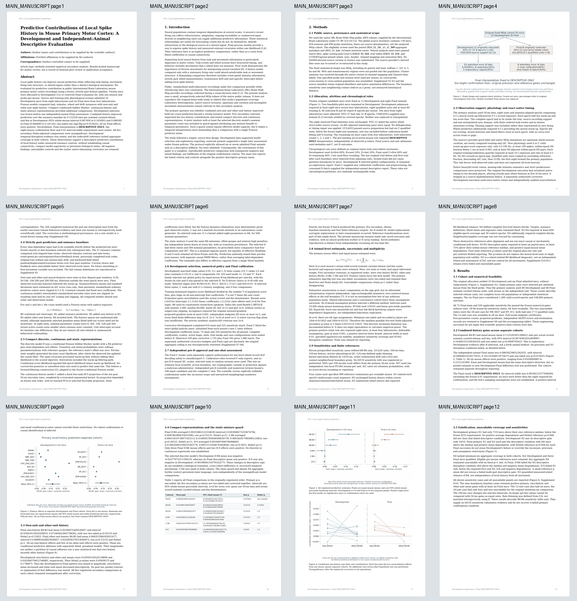
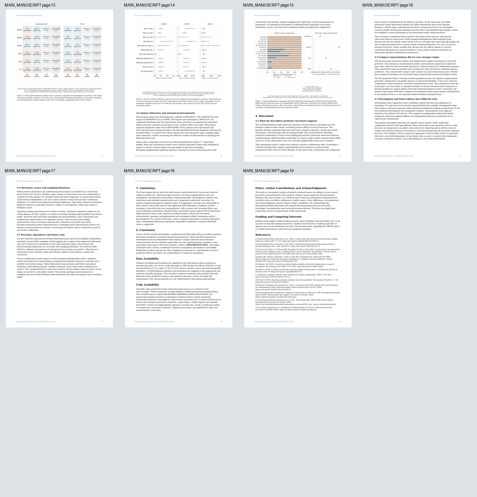
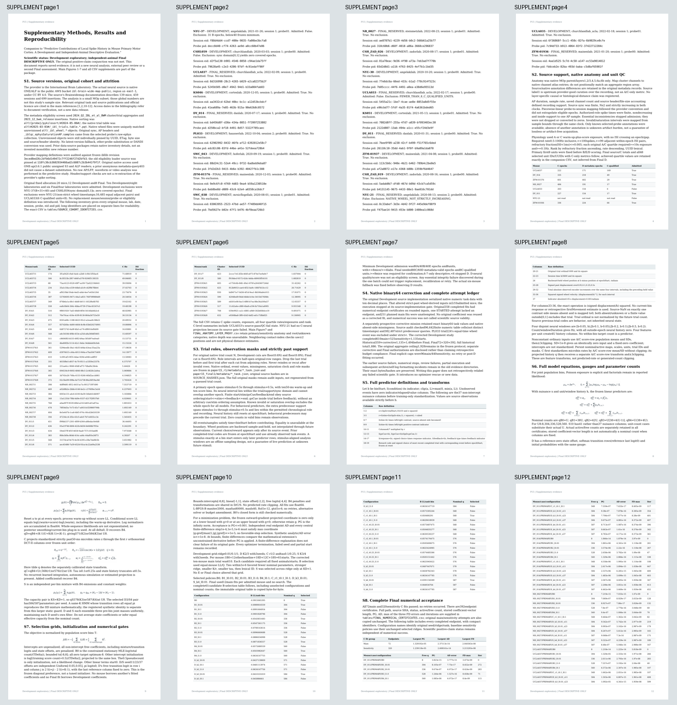
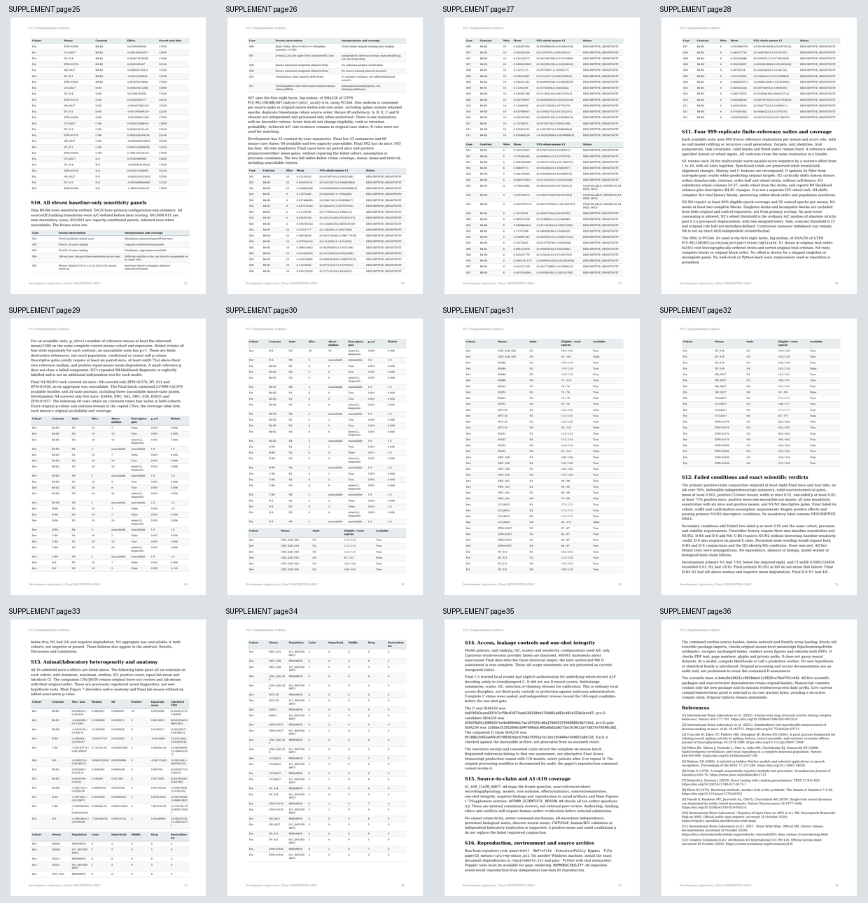
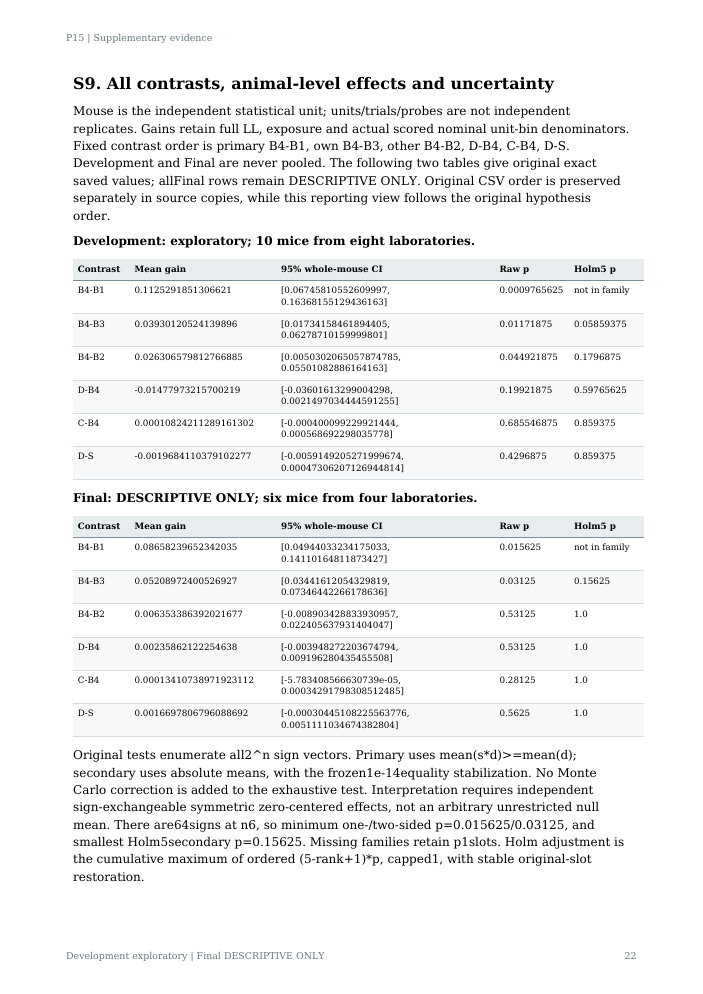

# Frozen PDF visual review

All 55 pages reviewed in contact-sheet overview; detailed representative pages for equations, references, full-precision tables; all seven figures inspected individually. This is visual document QA, not new scientific evaluation. Automated text, glyph, page-boundary and numeric checks also pass.

