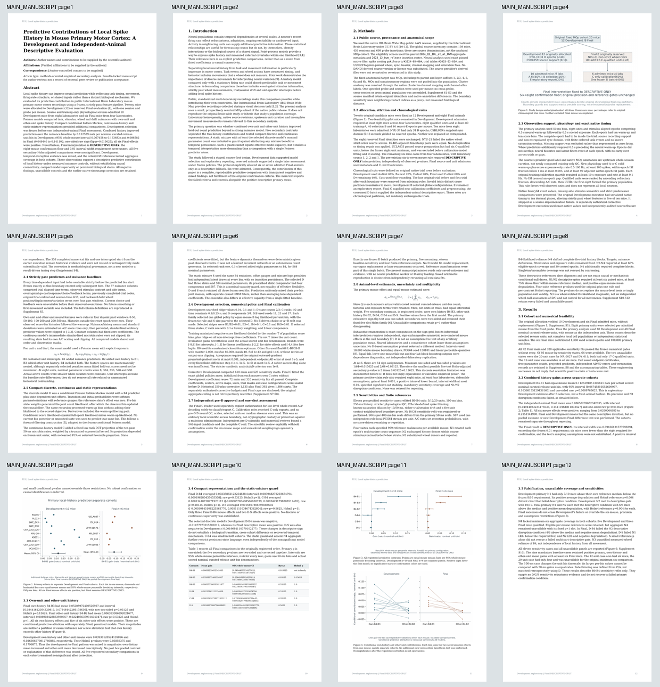
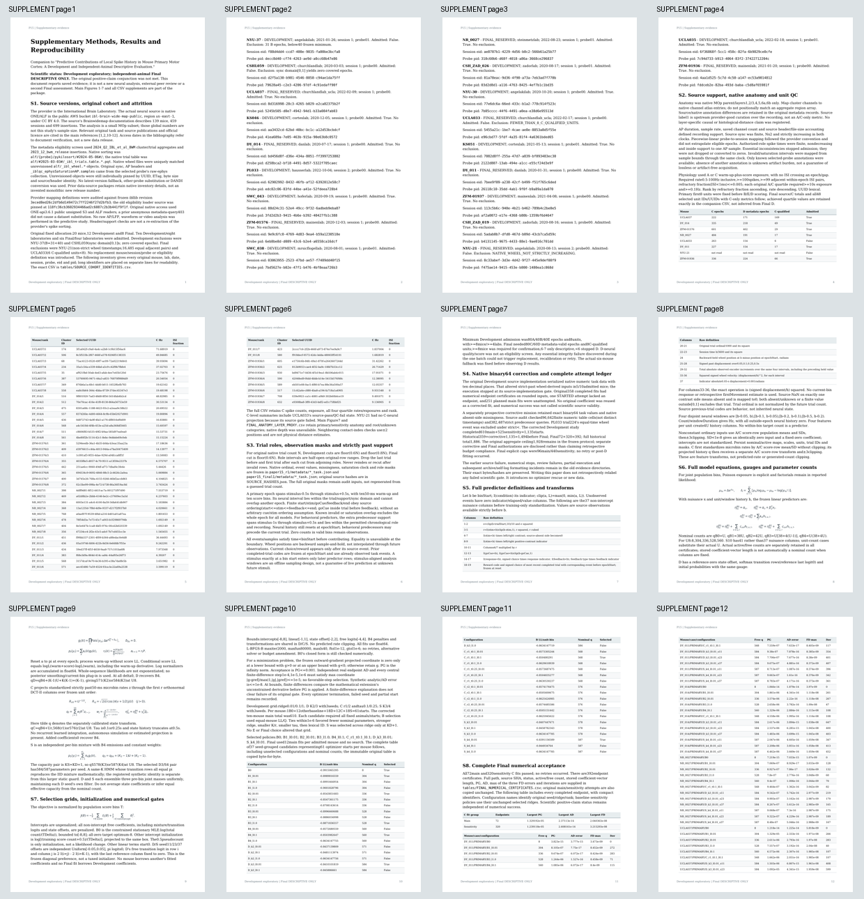
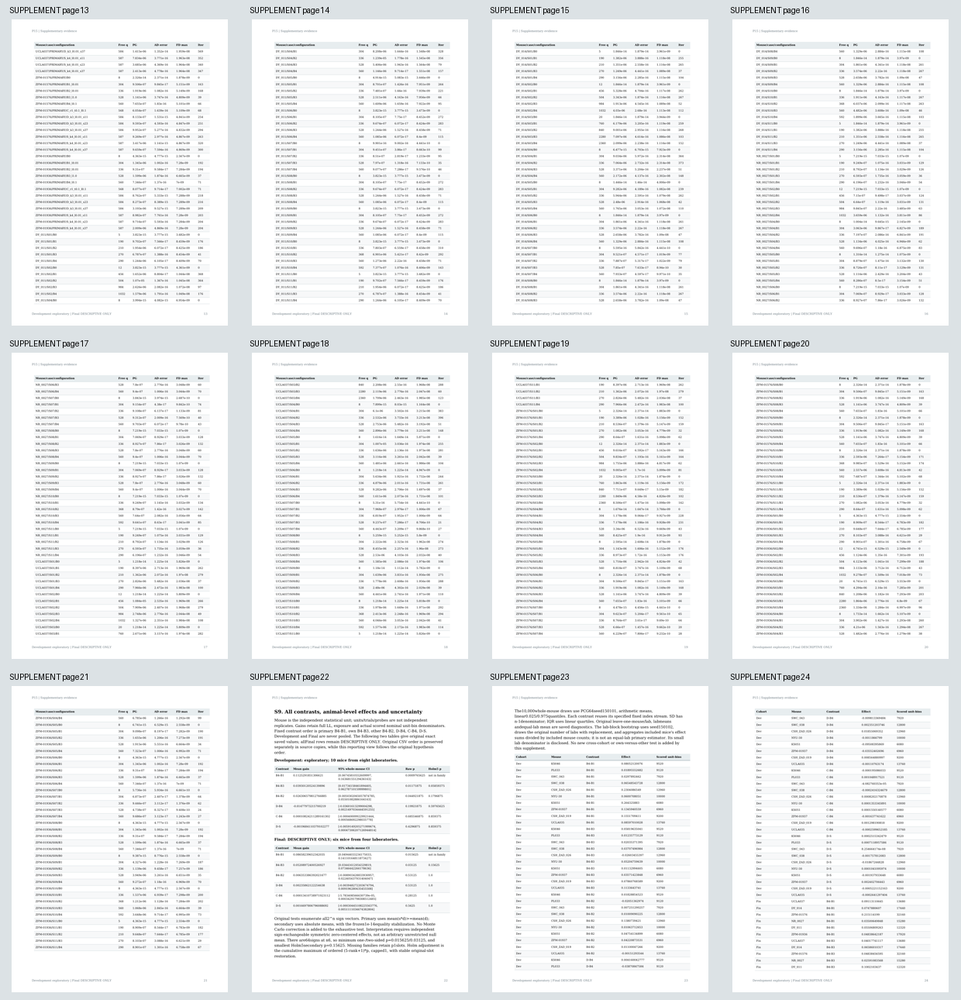
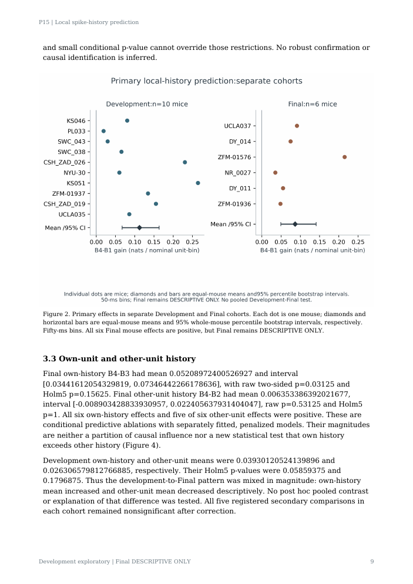
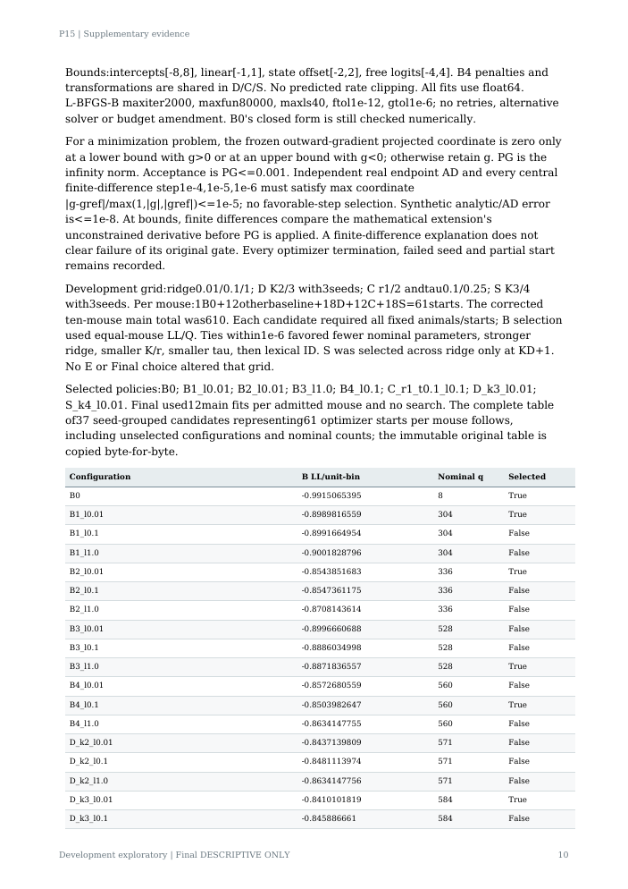

# Current repaired publication PDF visual review

Current all55page contact sheets inspected; full newFigure2 showsall16mousepoints,includingKS051; changedS7fullpage10examined; unchanged6figures retain earlierindividualinspection and identicalhashes. Automatedallpagebounds/glyph/numeralchecksand10regressionsPASS.

