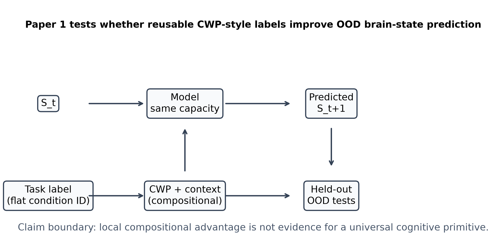
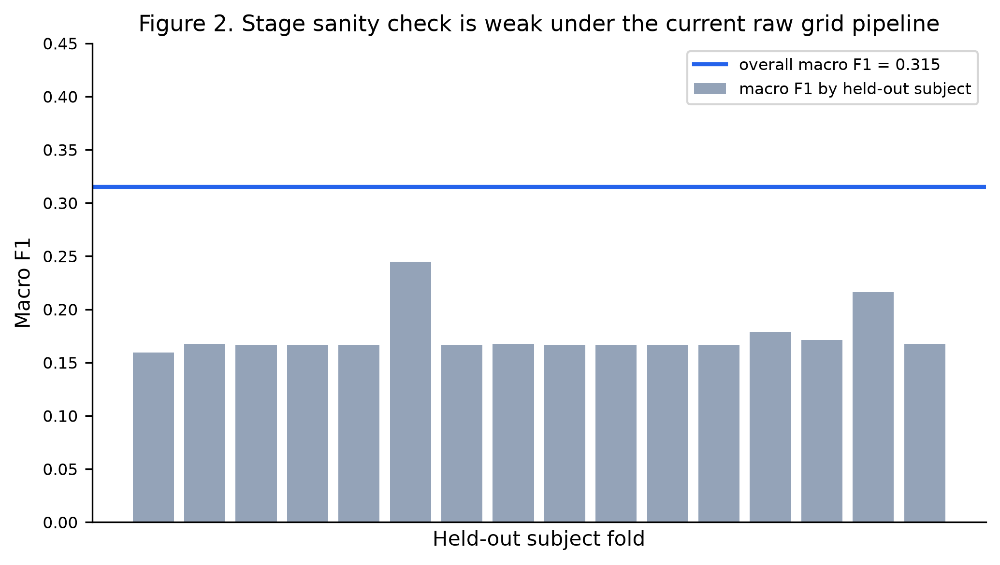
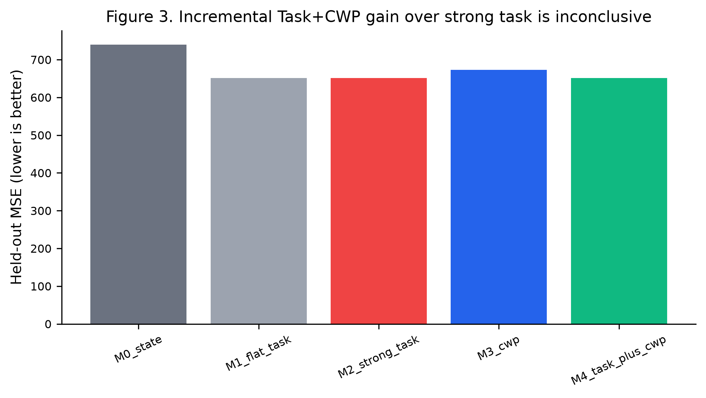
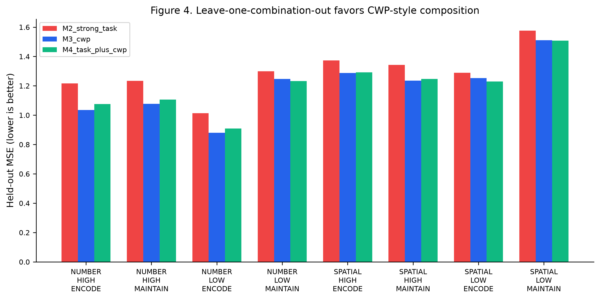
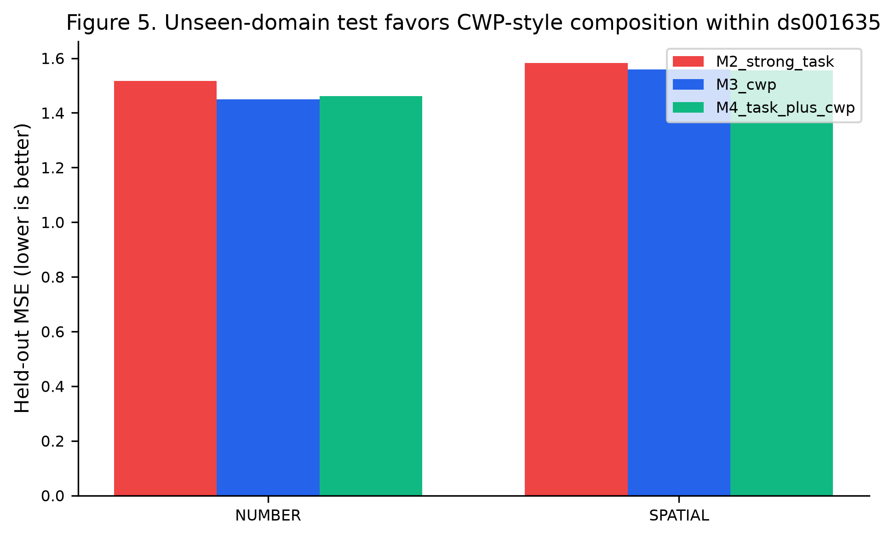
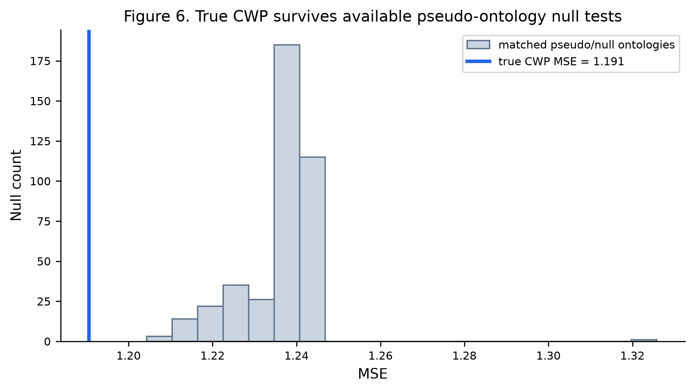
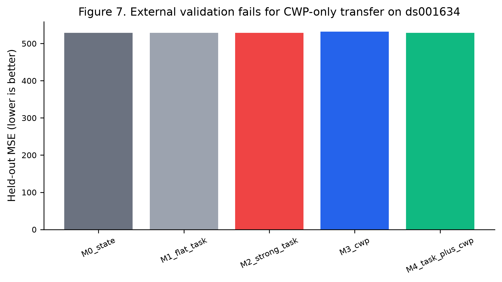

# CWP-style Compositional Representations Improve Within-dataset Out-of-distribution Brain-state Prediction but Do Not Yet Generalize Across Independent Datasets

Authors: `[AUTHOR NAMES TO BE FILLED]`

Affiliations: `[AFFILIATIONS TO BE FILLED]`

Correspondence: `[CORRESPONDING AUTHOR EMAIL TO BE FILLED]`

## Abstract

Task-fMRI labels often describe whole experimental conditions, but cognitive theories often require reusable intermediate descriptions of what a participant is doing at a finer functional level. We evaluated whether Cognitive Work Primitive (CWP)-style labels provide a more reusable representation for predicting human brain-state transitions than dataset-specific flat task labels. Using downloaded OpenNeuro working-memory fMRI datasets, we implemented a frozen E0-E8 pipeline: data/QC audit, stage-level brain-state extraction, stage sanity check, task-vs-CWP model comparison, unseen-combination holdout, unseen-domain holdout, null tests, external validation, and claim audit. The primary ds001635 run extracted 2,291 stage states from 48 BOLD runs using a fixed native image-space 216-ROI grid. The external ds001634 run extracted 3,066 stage states. Within ds001635, CWP-style representations improved held-out MSE in leave-one-combination and unseen-domain tests relative to the strong task baseline. However, the subject-held-out incremental comparison was inconclusive, stage separability was weak under the current raw grid pipeline, and external validation on ds001634 failed. These results support a narrower conclusion: CWP-style compositional labels can produce within-dataset out-of-distribution signal, but the current CWP v1 ontology and state-extraction pipeline do not establish a dataset-invariant cognitive primitive representation.

## 1. Introduction

### 1.1 Problem

Whole-task labels such as a dataset-specific task condition are often convenient for modeling fMRI experiments, but they are not necessarily reusable across new task combinations, domains, or datasets. Large task-fMRI resources have shown that experimental task conditions and working-memory manipulations produce measurable neural signatures [1,2]. However, a flat condition label can identify a condition seen during training while carrying little explicit structure about whether the condition contains encoding, maintenance, retrieval, or another cognitive operation.

### 1.2 Existing Methods and Gap

Existing task labels can capture experimental conditions, and strong task baselines can be built by assigning separate parameters to condition identities and contextual variables. In working memory, prior work has shown that stimulus domains and processing stages can be decoded from multivariate activity and connectivity patterns, including across independent fMRI studies [3]. Broader work on brain-state dynamics also supports the value of modeling temporal neural trajectories instead of only static activation maps [4,5].

The open question tested here is not whether task labels can fit known data. The stronger question is whether a reusable compositional representation can predict brain-state transitions when an exact task combination, domain, or dataset is held out. This question is aligned with a broader machine-learning concern: in-distribution performance does not by itself establish out-of-distribution or compositional generalization [6,7].

### 1.3 Proposed Method

We represent each transition using a current brain state, a CWP label, and contextual variables. In the current CWP v1 ontology, the primary CWP labels are:

- ENCODE
- MAINTAIN
- PROBE

TRANSFORM is treated as exploratory and is not used as a primary claim-bearing primitive.

### 1.4 Evaluation Questions and Hypotheses

Primary hypothesis:

```text
P(S_t+1 | S_t, CWP, Context) > P(S_t+1 | S_t, TaskLabel)
```

Operational gates:

```text
Gate A: Task + CWP improves over the strong task baseline.
Gate B: CWP improves OOD prediction in unseen-combination and unseen-domain tests.
Gate C: CWP direction is consistent in an independent external dataset.
```

### 1.5 Contributions

This paper contributes a frozen E0-E8 analysis pipeline, a direct M0-M4 model comparison, within-dataset OOD tests, null/falsification tests, and an external boundary test. The contribution is not a proof that CWP is a universal cognitive primitive. The contribution is a constrained empirical result: local compositional advantage appears in ds001635, but external generalization fails in the current v1 pipeline.



## 2. Methods

### 2.1 Dataset

The primary dataset is OpenNeuro ds001635. Local audit found 48 events files and 48 BOLD NIfTI files. The dataset description reports the name `Visual working memory: Study two Task fMRI and Behavioural response`, license `Creative Commons Attribution 4.0 International (CC-BY 4.0)`, and DOI `10.18112/openneuro.ds001635.v1.0.1`. This dataset corresponds to Study 2 from Soreq, Leech, and Hampshire [3].

The external validation dataset is OpenNeuro ds001634. Local audit found 57 events files and 57 BOLD NIfTI files. The dataset description reports the name `Visual working memory: Study one Task fMRI and Behavioural response`, license `Creative Commons Attribution 4.0 International (CC-BY 4.0)`, and DOI `10.18112/openneuro.ds001634.v1.0.1`. This dataset corresponds to Study 1 from the same source publication [3].

### 2.2 Cohort and Inclusion Criteria

All locally downloaded runs with matching event files and BOLD files were included. The local E0 audit found 16 subjects with 3 runs each in ds001635. Primary ds001635 extraction produced 2,291 ENCODE/MAINTAIN/PROBE stage states. External ds001634 extraction produced 3,066 ENCODE/MAINTAIN/PROBE stage states. No additional participant exclusion was applied beyond available local file matching in the current pipeline.

### 2.3 Preprocessing

The current run used the downloaded BOLD files directly with a fixed native image-space grid representation. A 6 x 6 x 6 grid produced 216 ROI columns. This is a reproducible engineering representation and must not be interpreted as a neuroanatomical atlas.

No confounds files were found in the current local pull, so motion-only falsification is not complete.

### 2.4 Frozen Protocol

The E0-E8 chain was:

```text
E0 Data/QC Audit
E1 Brain-State Extraction
E2 CWP Existence
E3 Task vs CWP
E4 Unseen Combination
E5 Unseen Domain
E6 Null/Falsification
E7 External Dataset
E8 Statistics + Reproduction
```

The v1 freeze rule is:

```text
Do not tune CWP v1 ontology, preprocessing, alignment, model structure, success thresholds, or metric choice against ds001634 to rescue Gate C.
```

### 2.5 Proposed Representation

For each trial stage, E1 estimated a stage-level state vector:

```text
S_stage in R^216
```

Transitions were constructed between consecutive primary CWP stages:

```text
ENCODE -> MAINTAIN
MAINTAIN -> PROBE
```

Each transition retained:

```text
subject, run, trial_id, source_cwp, target_cwp, domain, load, context, task_id
```

### 2.6 Baselines

Five models were compared:

```text
M0_state: S_t+1 = F(S_t)
M1_flat_task: S_t+1 = F(S_t, TaskID)
M2_strong_task: S_t+1 = F(S_t, TaskID, Domain, Load)
M3_cwp: S_t+1 = F(S_t, CWP, Domain, Load)
M4_task_plus_cwp: S_t+1 = F(S_t, TaskID, CWP, Domain, Load)
```

All models used the same prediction target and state representation. The only modeled difference was label representation.

### 2.7 Ablation Design

The main ablation is the M0-M4 comparison, which separates state-only prediction, flat task labeling, strong task conditioning, CWP conditioning, and combined task+CWP conditioning.

### 2.8 Holdout Design

E3 used leave-one-subject-out evaluation. E4 used leave-one-cell-out over Domain x Load x CWP. E5 used leave-one-domain-out. E7 trained on ds001635 stage states and tested on ds001634 external stage states without changing the CWP ontology.

### 2.9 Metrics

The primary reported metric in the current run is MSE. Secondary metrics are computed by the scripts where available, including R2 and cosine similarity. E8 also emits subject/evaluation-unit paired effects, bootstrap intervals, sign-flip permutation p-values, and FDR-adjusted q-values.

### 2.10 Statistical Analysis

E8 aggregates model metrics and computes paired differences between M2_strong_task and M3_cwp/M4_task_plus_cwp. Gate status is determined by the frozen claim audit rather than by isolated metric inspection.

### 2.11 Null and Robustness Tests

E6 implemented:

- label shuffle
- pseudo-CWP ontology
- domain/load-preserving label shuffle
- subject shuffle
- time-only baseline

Motion-only and boundary-jitter nulls remain incomplete because confounds were not available and event-level boundary perturbation plus E1 rerun remains to be implemented.

### 2.12 QC and Leakage Controls

E0 confirmed ds001635 local availability:

```text
n_events: 48
n_bold: 48
n_roi_timeseries: 48
n_confounds: 0
external_stage_states_present: true
```

Feature standardization and categorical encoders are fit on training rows only. E3, E4, E5, and E7 isolate held-out subjects, condition cells, domains, or datasets according to the experiment.

## 3. Results

### 3.1 Data Extraction

E1 extracted 2,291 ds001635 stage states and 3,066 ds001634 external stage states, each with 216 ROI features.

### 3.2 Stage Sanity Check

E2 subject-held-out stage decoding gave:

```text
accuracy: 0.3356612832824094
macro_f1: 0.3153017767921555
label_counts: ENCODE 768, MAINTAIN 768, PROBE 755
```

This result does not show strong ENCODE/MAINTAIN/PROBE separability under the current raw native-grid pipeline.



### 3.3 Subject-held-out Task vs CWP Comparison

E3 mean MSE:

```text
M0_state: 739.9842107977023
M1_flat_task: 651.1084620470139
M2_strong_task: 651.1084916855937
M3_cwp: 673.3670453189366
M4_task_plus_cwp: 651.1084167356842
```

Gate A was inconclusive. M4_task_plus_cwp was only trivially better than M2_strong_task, and the subject-level interval crossed 0.



### 3.4 Unseen-combination Holdout

E4 mean MSE:

```text
M2_strong_task: 1.2930225316211859
M3_cwp: 1.1905904151828643
M4_task_plus_cwp: 1.2001512696937149
```

This supports a within-dataset compositional advantage in leave-one-combination-out prediction.



### 3.5 Unseen-domain Holdout

E5 mean MSE:

```text
M2_strong_task: 1.549553729346369
M3_cwp: 1.5035537034522544
M4_task_plus_cwp: 1.5084872262939564
```

This supports a within-dataset compositional advantage in unseen-domain prediction.



### 3.6 Null and Falsification Results

E6 reported:

```text
true_cwp_mse: 1.1905904151828643
pseudo_cwp_survival_percentile: 1.0
required_survival_percentile: 0.99
```

This indicates that the true CWP labels outperformed the sampled pseudo-CWP ontologies in the implemented null suite. However, the motion-only and boundary-jitter nulls were not completed.



### 3.7 External Validation

E7 mean MSE:

```text
M0_state: 528.9595753463202
M1_flat_task: 529.0050987946481
M2_strong_task: 529.0031639473207
M3_cwp: 532.1089214151368
M4_task_plus_cwp: 528.9681855141137
```

Gate C failed because M3_cwp did not outperform M2_strong_task on ds001634 external validation.



### 3.8 Claim Audit

E8 reported:

```text
Gate A incremental: INCONCLUSIVE
Gate B OOD: PASSED
Gate C external: FAILED
claim_allowed_cwp_foundation_holds: false
claim_allowed_cwp_clearly_outperforms_task_labels: false
```

## 4. Discussion

### 4.1 What Worked

The within-dataset OOD tests were positive. In ds001635, the CWP-style representation had lower MSE than the strong task baseline in both unseen-combination and unseen-domain evaluations.

### 4.2 Why It May Have Worked

The likely interpretation is compositional reuse within a shared experimental structure: CWP labels allow the model to reuse ENCODE/MAINTAIN/PROBE information across domain/load combinations rather than treating every condition as independent. This is an interpretation of the observed pattern, not a mechanistic proof.

### 4.3 Generalization

The external dataset result is the central boundary. CWP v1 did not transfer successfully to ds001634. Therefore, local compositional advantage does not establish a general cognitive primitive.

### 4.4 Failure Cases

The strongest failures are:

- E2 did not show robust subject-held-out stage separability under this raw grid representation.
- E3 did not show decisive incremental value of Task+CWP over the strong task baseline.
- E7 failed on external validation.

### 4.5 Limitations

The current state representation uses a native image-space grid rather than a neuroanatomical atlas. Motion confounds are not modeled because confounds files were not found. The boundary-jitter null is not yet implemented. The external failure may reflect ontology mismatch, task-design mismatch, state-extraction mismatch, dataset/scanner shift, or genuine non-generalization of CWP v1.

### 4.6 Future Work

Future work should not tune CWP v1 against ds001634 to make Gate C pass. A separate CWP v2 study should be frozen before using this external failure for redesign. Minimum v2 requirements include explicit ontology alignment, neuroanatomical or template-space atlas selection, confound/motion handling, stage timing sensitivity, dataset harmonization, and a new untouched external holdout.

## 5. Conclusion

This study does not validate CWP v1 as a general cognitive primitive representation. It provides a more constrained result: CWP-style compositional labels improved within-dataset OOD brain-state prediction in ds001635, but the strong claim failed because incremental evidence was inconclusive and external validation on ds001634 failed. Paper 1 should therefore be treated as a compositional advantage and external boundary-test paper, not as a CWP foundation-proof paper.

## Data Availability

Publication supplement: [P1 data sources, sample manifests, access conditions, and figure provenance](../DATA_AVAILABILITY.md). Code, papers, and derived results are published at [neuralsignal-theory/test](https://github.com/RiconasSun/neuralsignal-theory/tree/test). Raw participant imaging/signals and tractography remain with the original data providers and are not redistributed. The supplement records dataset identifiers and versions available in existing evidence, links to cohort/pipeline records, and distinguishes unrecorded historical metadata from verified information. Exact local withheld filenames and SHA256 values are recorded in [the raw file inventory](../../publication/raw_file_inventory.csv); derived artifacts and figures have [SHA256 checksums](../../publication/artifact_checksums.csv).

OpenNeuro ds001635 and ds001634 were downloaded locally through `openneuro-py`. The local dataset metadata identifies ds001635 as DOI `10.18112/openneuro.ds001635.v1.0.1` and ds001634 as DOI `10.18112/openneuro.ds001634.v1.0.1`. Both local dataset descriptions state Creative Commons Attribution 4.0 International (CC-BY 4.0) licensing.

## Code Availability

The local analysis code is in:

```text
paper1/scripts/
```

The current package is not yet tied to a public repository URL: `[TO BE FILLED]`.

## Reproducibility Statement

The current reproduction command is documented in:

```text
paper1/attachments/A10_One_Command_Reproduction.md
```

The environment is frozen in:

```text
paper1/results/environment.lock
```

## Ethics Statement

This study reanalyzes publicly available, de-identified OpenNeuro datasets. The original data collection was reported by Soreq, Leech, and Hampshire as approved by the University of Western Ontario ethics committee [3]. No new human participant data were collected for this analysis.

## Funding

`[TO BE FILLED]`

## Author Contributions

`[TO BE FILLED]`

## Conflicts of Interest

`[TO BE FILLED]`

## References

1. Barch, D. M. et al. Function in the human connectome: Task-fMRI and individual differences in behavior. NeuroImage 80, 169-189 (2013). https://doi.org/10.1016/j.neuroimage.2013.05.033
2. Van Essen, D. C. et al. The WU-Minn Human Connectome Project: An overview. NeuroImage 80, 62-79 (2013). https://doi.org/10.1016/j.neuroimage.2013.05.041
3. Soreq, E., Leech, R. & Hampshire, A. Dynamic network coding of working-memory domains and working-memory processes. Nature Communications 10, 936 (2019). https://doi.org/10.1038/s41467-019-08840-8
4. Vidaurre, D. et al. Spontaneous cortical activity transiently organises into frequency specific phase-coupling networks. Nature Communications 9, 2987 (2018). https://doi.org/10.1038/s41467-018-05316-z
5. Lynn, C. W. & Bassett, D. S. The physics of brain network structure, function and control. Nature Reviews Physics 1, 318-332 (2019). https://doi.org/10.1038/s42254-019-0040-8
6. Miller, J. P. et al. Accuracy on the Line: On the Strong Correlation Between Out-of-Distribution and In-Distribution Generalization. Proceedings of the 38th International Conference on Machine Learning, PMLR 139, 7721-7735 (2021). https://proceedings.mlr.press/v139/miller21b.html
7. Ye, H., Xie, C., Cai, T., Li, R., Li, Z. & Wang, L. Towards a Theoretical Framework of Out-of-Distribution Generalization. Advances in Neural Information Processing Systems 34 (2021). https://papers.nips.cc/paper/2021/hash/c5c1cb0bebd56ae38817b251ad72bedb-Abstract.html
