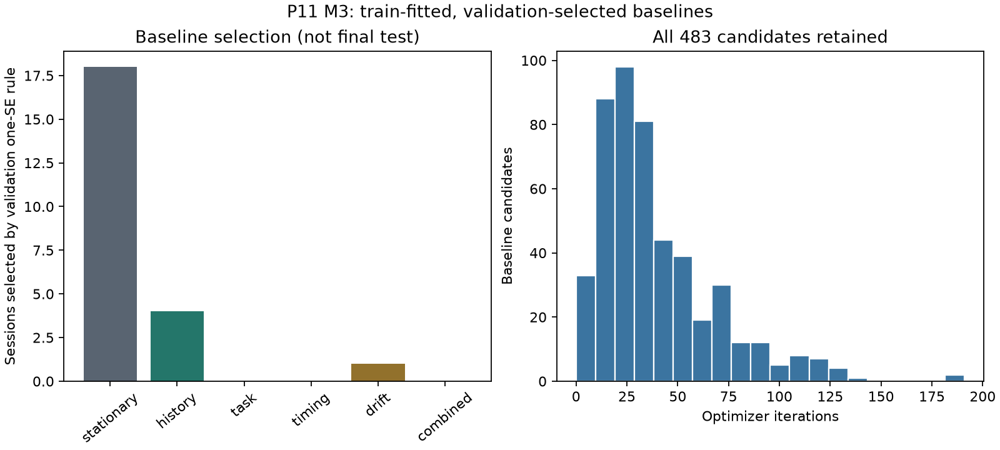

# Hippocampal Dynamical Regime

## Draft Status
Incomplete research package, not bioRxiv-ready. M0-M3 passed; M4 numerical gate
failed and execution stopped. No preferred dynamical regime,
holdout statistic, null outcome, external convergence or NAP/CWP validation exists.
Authorship, author approval and submission declarations remain NOT PROVIDED.

## Abstract
Human hippocampal population dynamics could be described by discrete, continuous,
or hybrid state-space models. A previously reported global continuous-model
advantage in P10 does not settle this regional question. We froze a prospective
hippocampal spike-count comparison protocol and audited fixed primary releases
NEMAR nm000363 v1.0.0 and OpenNeuro ds004752 v1.0.1. M1 selected 9 subjects,
23 sessions and 613 session-local hippocampal sorted units. Training-only 100 ms
count extraction conserved 292,615 preprobe spikes across 622 trials. Exact
per-unit trial-array observation coverage required auditing the fixed NEMAR NIX
objects, obtained through a documented public annex remote after initial access
failures. All23 selected-session inventories passed. All483 prespecified baseline
candidates converged; validation one-SE selected stationary/history/drift in
18/4/1 sessions. Regime fitting and marginal likelihood accuracy assessment are
stopped at a failed integration-accuracy diagnostic; final holdout remains unopened.
No dynamical regime preference follows.

## 1. Introduction
The falsifiable question is whether discrete Poisson-HMM, continuous Poisson
latent dynamics or hybrid switching dynamics provide reproducibly better causal
heldout count predictions than each other and strong task/timing/history/drift
baselines. A whole-brain result cannot alone rule out region-specific dynamics.
The unit of independent inference is subject, not neuron, session or time bin.
Literature review and novelty assessment: NOT COMPLETED. P10 context above is
the project's reported prior evidence, not an independently rerun P10 analysis.

## 2. Methods
### 2.1 Fixed Data and Cohort
Primary releases and Git commits are frozen in protocol/protocol.json. NEMAR
spike tables are analyzed independently from companion iEEG. M1 metadata and
electrode crosswalks identify hippocampus explicitly, excluding other MTL labels
from primary analysis. Units are session-local; SU/MU categories are unresolved.
One selected session is explicitly unpaired to the companion recording.

### 2.2 Frozen Splits and Features
Whole trials are partitioned chronologically 60/20/20 after metadata-only QC.
The immutable split SHA256 is
d66ff7cc5dcadf3e0b7f18bfddcb50f3baa8fe59fc28b999910b3b66bd3e1eaa.
Unit selection uses training observations only. Primary counts use 100 ms bins
over [-6,0) relative to probe, left-closed/right-open. Trial boundaries reset
history. M2 reads training timestamps only; validation/test columns remain opaque.
Set size is available as a predictor only from encoding; response/probe fields
are excluded. Epoch timing is conditioned on the known task schedule.

### 2.3 Planned Comparisons
The unchanged frozen protocol specifies six baseline families, Poisson HMM,
continuous Poisson latent and hybrid switching models, matched masks/covariates,
validation-only complexity selection and joint marginal one-step count likelihood.
No plug-in reconstruction or ELBO is to substitute for predictive likelihood.
Baseline candidates have been fitted. Regime training and estimator accuracy
assessment stopped at the failed smoke gate. Common combined causal GLM offsets are fixed across
families; Gaussian process/initial covariance is fixed identity. Variational
ELBO is for training only, never the cross-family predictive metric.

### 2.4 Planned Statistics and Falsification
Paired subject-level differences, 10,000 subject bootstrap resamples, exact
sign-flip testing and Holm correction are prespecified. Rate-preserving,
jitter, time-shift, trial-position and random-segmentation controls are required.
No such statistic or null result has been computed. With six subjects, minimum
exact sign-flip p cannot pass the first six-comparison Holm threshold; the actual
9-subject cohort avoids that particular mathematical floor. Sidedness/tie rules
still require an implementation-level specification before model evaluation.

### 2.5 Observation-Coverage Audit
The fixed converter records a spike-time array's existence before iterating its
values, supporting zeros for empty arrays under the released trial convention.
Its exported array cardinality does not prove exact trial membership or absence
of duplicate/extraneous arrays. A checksum-bound NIX metadata-only validator was
implemented to check array names, unit/microwire identity, numeric rank-one
seconds schema and exact trial coverage without loading spike values or lengths.
Initial GIN access failed; documented public S3 annex objects restored coverage.
All23 whole-file masked checksums and exact inventories passed. Publisher-pinned
provenance attests masking administrative timestamp attributes only, not arrays.
Original/masked identities are separate; array-value equivalence was not
independently rerun, and uninterrupted acquisition remains a dataset convention.

## 3. Results
### 3.1 Data and Conditional Training QC
M1 audited 37 sessions and 1,526 sorted units; 23 sessions qualified. Of 676
hippocampal labeled units, 630 passed unit QC and 613 belonged to eligible session
populations. M2 conditional training features comprised 1,005,120 unit-bins,
292,615 spikes and 80.764386% zero-count bins. The count sums match M1 exactly.
Three progressive extraction stages completed. Automated count/schema tests
pass; this does not independently prove dropout-free physiological observation.

### 3.2 Scientific Stop and Missing Results
Three recorded GIN endpoints returned403 under HEAD and bounded GET. Annex
resolution recovered all23 selected sources (11,387,335,686 bytes), checksum
verified before metadata audit. Earlier coverage gates retained, never used to
advance. All483 baseline candidates converged. Full validation results are in
results/progress/baseline_validation_all.csv; candidate fits and selection in
results/M3/sessions. M4 serialization and estimator-oracle repairs are disclosed
and versioned, without model/grid/tolerance changes or final-test access.
Final holdout statistics, nulls, within-subject and external tests: NOT EXECUTED.

The corrected single-run marginal-likelihood accuracy diagnostic for the
sub-01/ses-01 continuous d=1 candidate failed at all frozen budgets. Conservative
discrepancies were 0.009484312522032967, 0.0027676139728540633 and
0.0014080063396446991 nats/unit-bin at 64, 256 and 1024 particles, respectively,
against a 0.001 threshold. Reference uncertainty was 0.00010224930758077136.
This empirical diagnostic does not establish absolute integration error. Failure
prevents a valid matched regime comparison; it is not evidence against continuous
hippocampal dynamics. Hybrid code exists but its real-data fitting did not execute.
Full-cohort regime fitting did not execute. Final regression: 70 tests passed.

## 4. Discussion
The evidence supports reproducible training counts, explicit anatomical
eligibility and train-fit/validation-select baseline execution, not a regime
preference. Exact array metadata resolves missing-array uncertainty; it does not
prove dropout-free physiological acquisition. Baseline selections are validation
outcomes, not final-test generalization or neural-state ontology findings.
Limitations include session-wide upstream sorting, unresolved SU/MU labels,
session-local identities, clinical sampling, unequal session coverage and absence
of independent per-bin dropout masks. No direct different-task replication is
claimed. The observed access failure is not evidence that neural data are missing.

## 5. Conclusion
The regional question has no final holdout answer. Model convergence and
predictive-integration accuracy must pass before any preferred-regime claim.

## Data and Code Availability
Pinned primary provenance, checksums, metadata and conditional derived outputs
are in paper11/data_manifest and paper11/results. Raw files remain local/ignored;
CC-BY-SA-4.0 license accompanies derived outputs. Code is on the repository test
branch. Source links: [pinned NEMAR release](https://github.com/nemarDatasets/nm000363/tree/b054fbef57f9c4fb93477ecc5c88c6114dbc5662),
[pinned companion release](https://github.com/OpenNeuroDatasets/ds004752/tree/234fd4c04dea66ab9b0fd5ddbf4ec51f56b6ad02).

## Reproducibility, Ethics and Declarations
M2 PowerShell reproduction regenerates counts/tests/coverage/figures; M3 fits all
prescribed baselines, M4 assesses models and predictive-integration accuracy.
This is not yet full-paper reproduction.
Only publicly released data are used. Original ethics/consent provenance is in
the source dataset; no new human data were collected. Author contributions,
conflicts, funding and final author approval: NOT PROVIDED; never inferred.
